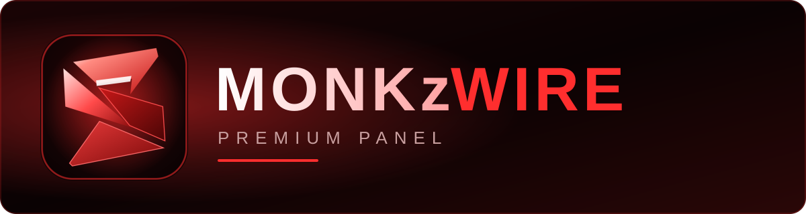
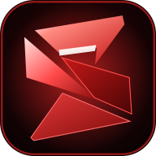

 

### 🔓 [Open Panel](https://monkzwire.vercel.app) &nbsp;•&nbsp; 🛒 [Buy Key](https://monkzwire.vercel.app/store.html) &nbsp;•&nbsp; 💬 [Help](https://monkzwire.vercel.app/help)

---

## 📑 Contents
[Overview](#-overview) · [Highlights](#-highlights) · [Features](#-features) · [Prices](#-prices) · [License Keys](#-license-keys) · [FAQ](#-faq) · [Admin & Support](#-admin--support)

---

## 🔥 Overview

**MONKz WIRE** is a premium panel with a key-protected dashboard, a full hacks menu and a built-in store. Unlock with your license key, switch features on or off, fine-tune them with sliders and track your remaining time live.

| 🔐 Key Access | 🎛️ Hacks Menu | ⏱ Live Timer | 🛒 Store | 💬 Support |
|:---:|:---:|:---:|:---:|:---:|
| `XXXX-XXXX-XXX` | 48 features | Per-key expiry | 5 plans | Discord |

---

## ✨ Highlights

- 🔐 **Key-protected access** — keys look like `XXXX-XXXX-XXX`, each made for one time length (12 hours to lifetime)
- 🧭 **Proper panel layout** — Dashboard, Aim, Visuals, Weapons, Player, Misc, Settings, Profile, Status, Changelog, Downloads and Support
- ⏱ **Live license timer** — plan, key tail and exact time left, with a warning before expiry
- 🔍 **Search & presets** — find any hack fast (press `/`), apply Legit / Balanced / Full in one click
- 💾 **Saved configs** — name and keep several setups, copy and load them anywhere
- 🎨 **Accent colors** — switch the panel between red, blue, purple, green, orange and pink
- 🛒 **Built-in store** — plans, comparison table and one-click order on Discord
- 🛡️ **Cloudflare ready** — optional Turnstile human check and Web Analytics
- 📱 **Install on your phone** — add to home screen like an app, works on every screen up to 4K

---

## 🎯 Features — 48 total

### 🔴 AIM
| Feature | Description |
|:---|:---|
| **Auto Headshot** | Automatic head targeting |
| **Aim Lock** | Lock onto the nearest target |
| **Silent Aim** | Aim without visible camera movement |
| **Aim FOV** | Aim assist field of view |
| **Smooth Aim** | Natural-looking aim movement |
| **Aim Distance** | Maximum targeting distance |
| **Visible Check** | Only target visible enemies |
| **Knocked Check** | Skip knocked players |
| **Target Prediction** | Predict moving targets |
| **Aim On Fire** | Assist only while firing |
| **Bone Selector** | Head, neck or chest |

### 👁️ VISUALS
| Feature | Description |
|:---|:---|
| **ESP Box** | Player box overlay |
| **ESP Line** | Lines to players |
| **ESP Skeleton** | Skeleton overlay |
| **ESP Health** | Health bar display |
| **ESP Name** | Show player names |
| **ESP Distance** | Show distance |
| **Loot ESP** | Show nearby loot |
| **Vehicle ESP** | Show nearby vehicles |
| **Radar** | Mini radar |
| **Custom Crosshair** | Replace the crosshair |
| **Chams** | Highlight players through walls |

### 🔫 WEAPONS
| Feature | Description |
|:---|:---|
| **No Recoil** | Reduced recoil |
| **No Spread** | Tighter spread |
| **Fast Reload** | Quicker reloads |
| **Rapid Fire** | Faster fire rate |
| **Auto Fire** | Fire automatically on target |
| **Quick Switch** | Faster weapon switching |
| **Scope Zoom** | Adjustable zoom |

### 🏃 PLAYER
| Feature | Description |
|:---|:---|
| **Speed Boost** | Faster movement |
| **High Jump** | Higher jumps |
| **Fast Heal** | Quicker healing |
| **Auto Revive** | Faster revive |
| **Auto Pickup** | Pick up items automatically |
| **No Fall Damage** | Ignore fall damage |
| **Sprint Boost** | Longer sprint |

### 🧰 MISC
| Feature | Description |
|:---|:---|
| **Wide View** | Wider field of view |
| **Night Vision** | Brighter dark areas |
| **Clear Weather** | Remove fog and rain |
| **Quick Loot** | Faster looting |
| **Streamer Mode** | Hide overlays while streaming |
| **Notifications** | Toggle alerts |

### ⚙️ SETTINGS
| Feature | Description |
|:---|:---|
| **FPS Boost** | Lower lag, higher frames |
| **Safe Mode** | Extra stability checks |
| **Night Theme** | Dark glow intensity |
| **Panel Opacity** | Card transparency |
| **Sound Effects** | Click sounds |
| **Compact Mode** | Dense layout |

---|:---|
| **Auto Headshot** | Automatic head targeting |
| **Aim Lock** | Lock onto the nearest target |
| **Aim FOV** | Adjustable field of view |
| **Smooth Aim** | Natural-looking movement |

### 👁️ VISUALS
| Feature | Description |
|:---|:---|
| **ESP Box** | Player box overlay |
| **ESP Line** | Lines to players |
| **ESP Health** | Health bar display |
| **Loot ESP** | Show nearby loot |

### 🏃 PLAYER
| Feature | Description |
|:---|:---|
| **Speed Boost** | Faster movement |
| **No Recoil** | Reduced recoil |
| **Fast Reload** | Quicker reloads |

### ⚙️ SETTINGS
| Feature | Description |
|:---|:---|
| **FPS Boost** | Lower lag, higher frames |
| **Safe Mode** | Extra stability checks |
| **Night Theme** | Dark glow intensity |

---

## 💰 Prices

| Plan | Price | Duration | Support |
|:---|:---:|:---:|:---:|
| ⚡ **1 Day** | ₹99 | 24 hours | Standard |
| 🔥 **3 Days** | ₹199 | 3 days | Standard |
| 💎 **7 Days** ⭐ *Popular* | ₹349 | 7 days | Priority |
| 👑 **30 Days** | ₹799 | 30 days | Priority |
| ♾️ **Lifetime** *Best Value* | ₹1499 | Forever | VIP |

> ✅ Every plan includes **full panel access** and **all hacks unlocked**.
> 🛒 Order from the [Store](https://monkzwire.vercel.app/store.html) — your key is delivered on Discord.

---

## 🔑 License Keys

Keys look like **`XXXX-XXXX-XXX`**. Every key is made for **its own time length** — hours, days or lifetime — and the time starts when you enter the key for the first time.

---

## ❓ FAQ

<b>Where do I get a key?</b>

 
Open the <a href="https://monkzwire.vercel.app/store.html">Store</a>, choose a plan and press <b>BUY NOW</b>. You will be taken to Discord to complete your order.

<b>It says "Wrong key"</b>

 
Check for typos and enter it as <code>XXXX-XXXX-XXX</code>. Still not working? Press <a href="https://monkzwire.vercel.app/help">Help</a>.

<b>My key expired</b>

 
Buy a new key from the <a href="https://monkzwire.vercel.app/store.html">Store</a> and enter it on the unlock page.

<b>Which plan should I pick?</b>

 
Trying it out? <b>1 Day</b>. Regular use? <b>7 Days</b> is the most popular. Best value is <b>Lifetime</b>.

---

## 📞 Admin & Support

| | |
|:---|:---|
| 👤 **Admin** | [scriptermonk@gmail.com](mailto:scriptermonk@gmail.com) |
| 💬 **Help / Discord** | [monkzwire.vercel.app/help](https://monkzwire.vercel.app/help) → opens our Discord |
| 🎫 **Join** | [discord.gg/gZGJFyWUU](https://discord.gg/gZGJFyWUU) |
| 🛒 **Store** | [monkzwire.vercel.app/store.html](https://monkzwire.vercel.app/store.html) |

 

**© 2026 MONKz WIRE — All rights reserved**

