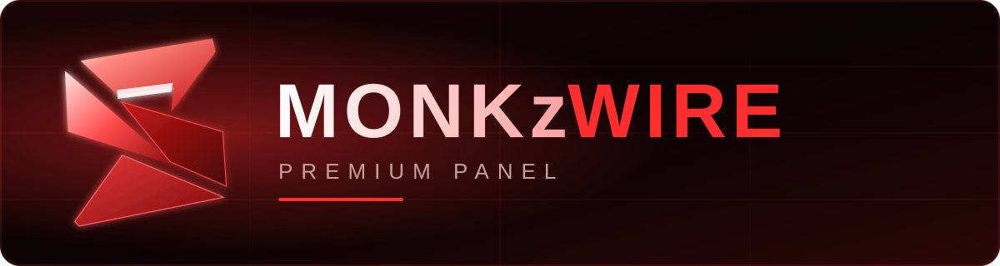
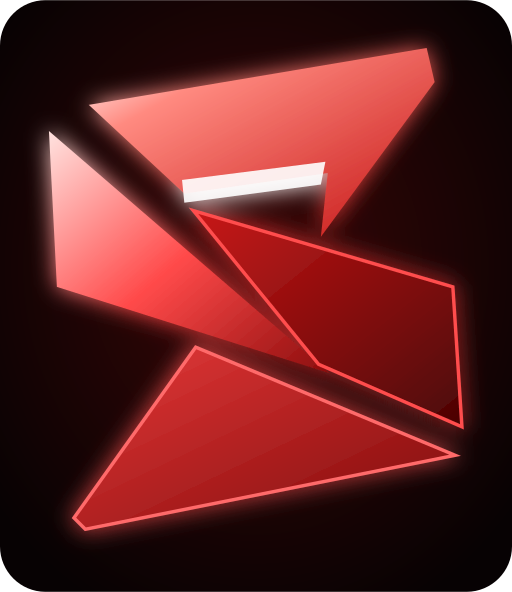

 

### 🛒 [Buy a Key](https://monkzwire.vercel.app/store.html) &nbsp;|&nbsp; 🔓 [Open Panel](https://monkzwire.vercel.app) &nbsp;|&nbsp; 💬 [Discord](https://discord.gg/gZGJFyWUU)

---

## 📑 Contents

[Overview](#-overview) · [Highlights](#-highlights) · [Features](#-features) · [Prices](#-prices) · [FAQ](#-faq) · [Contact](#-contact)

---

## 🔥 Overview

**MONKz WIRE** is a premium panel with a key-protected dashboard, a full hacks menu and a built-in store. Unlock with your key, switch features on or off, tune them with sliders, and renew anytime from the store.

| 🔐 Key Access | 🎛️ Hacks Menu | 🛒 Store | 💬 Support |
|:---:|:---:|:---:|:---:|
| `MONK-FFH4X-…` | 14 features | 5 plans | Discord |

---

## ✨ Highlights

- 🔐 **Key-protected access** — only valid keys open the panel
- 🎛️ **Hacks dashboard** — clean ON / OFF switches with live sliders
- 💾 **Remembers your setup** — your switches and values stay saved
- 🛒 **Built-in store** — choose a plan and order on Discord in one click
- 💎 **Premium dark-red design** — glass UI, glow and particle background
- 📱 **Every screen** — phone, tablet, desktop and 4K

---

## 🎯 Features

### 🔴 AIM
| Feature | Description |
|:---|:---|
| **Auto Headshot** | Automatic head targeting |
| **Aim Lock** | Lock onto the nearest target |
| **Aim FOV** | Adjustable field of view |
| **Smooth Aim** | Natural-looking movement |

### 👁️ VISUALS
| Feature | Description |
|:---|:---|
| **ESP Box** | Player box overlay |
| **ESP Line** | Lines to players |
| **ESP Health** | Health bar display |
| **Loot ESP** | Show nearby loot |

### 🏃 PLAYER
| Feature | Description |
|:---|:---|
| **Speed Boost** | Faster movement |
| **No Recoil** | Reduced recoil |
| **Fast Reload** | Quicker reloads |

### ⚙️ SETTINGS
| Feature | Description |
|:---|:---|
| **FPS Boost** | Lower lag, higher frames |
| **Safe Mode** | Extra stability checks |
| **Night Theme** | Dark glow intensity |

---

## 💰 Prices

| Plan | Price | Duration | Support |
|:---|:---:|:---:|:---:|
| **1 Day** | ₹99 | 24 hours | Standard |
| **3 Days** | ₹199 | 3 days | Standard |
| **7 Days** ⭐ *Popular* | ₹349 | 7 days | Priority |
| **30 Days** | ₹799 | 30 days | Priority |
| **Lifetime** 👑 *Best Value* | ₹1499 | Forever | VIP |

> ✅ Every plan includes **full panel access** and **all hacks unlocked**.
> 🛒 Order from the [Store](https://monkzwire.vercel.app/store.html) — your key is delivered on Discord.

---

## ❓ FAQ

<b>Where do I get a key?</b>

 
Open the <a href="https://monkzwire.vercel.app/store.html">Store</a>, choose a plan and press <b>BUY NOW</b>. You will be taken to Discord to complete your order.

<b>My key says "Wrong key"</b>

 
Keys start with <code>MONK-FFH4X</code>. Check for typos or extra characters, or contact us on Discord.

<b>Do I need to unlock every time?</b>

 
No. The panel remembers you on the same browser until you press <b>Lock</b>.

<b>Which plan should I pick?</b>

 
Trying it out? Take <b>1 Day</b>. Regular use? <b>7 Days</b> is the most popular. Best value is <b>Lifetime</b>.

---

## 📞 Contact

| | |
|:---|:---|
| 💬 **Discord** | https://discord.gg/gZGJFyWUU |
| 🛒 **Store** | https://monkzwire.vercel.app/store.html |

 

**© 2026 MONKz WIRE — All rights reserved**

